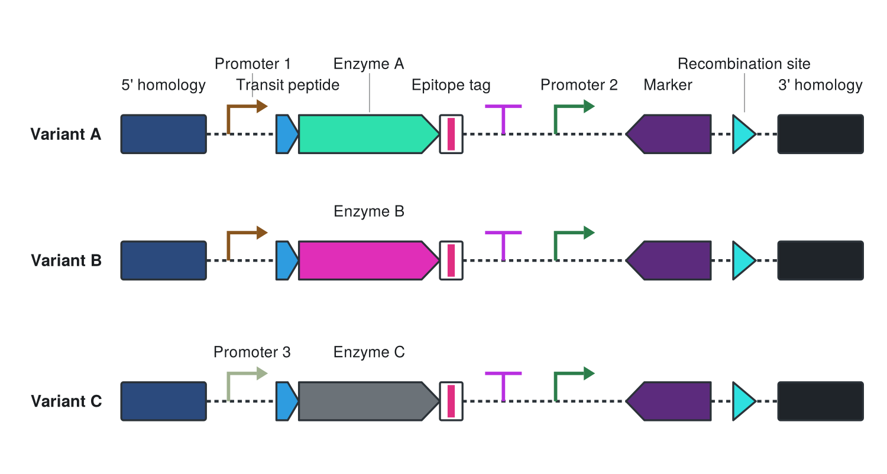
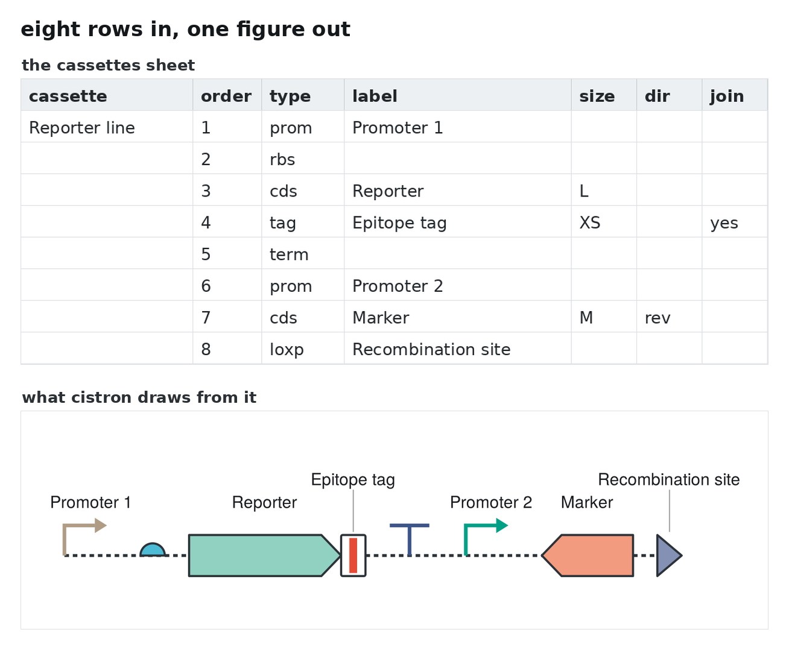
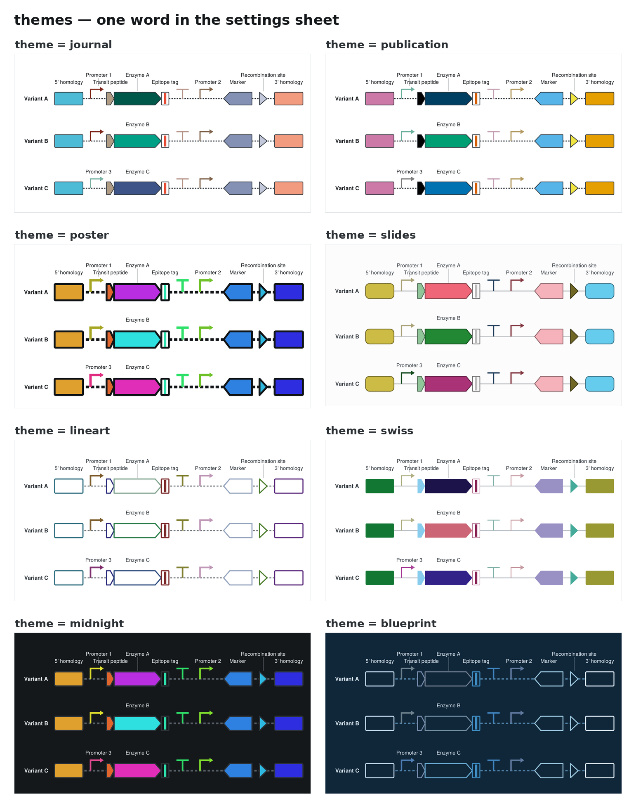
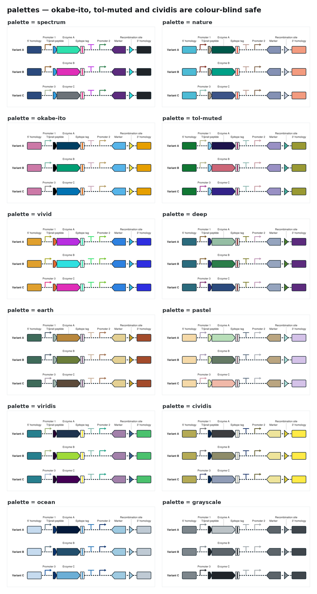
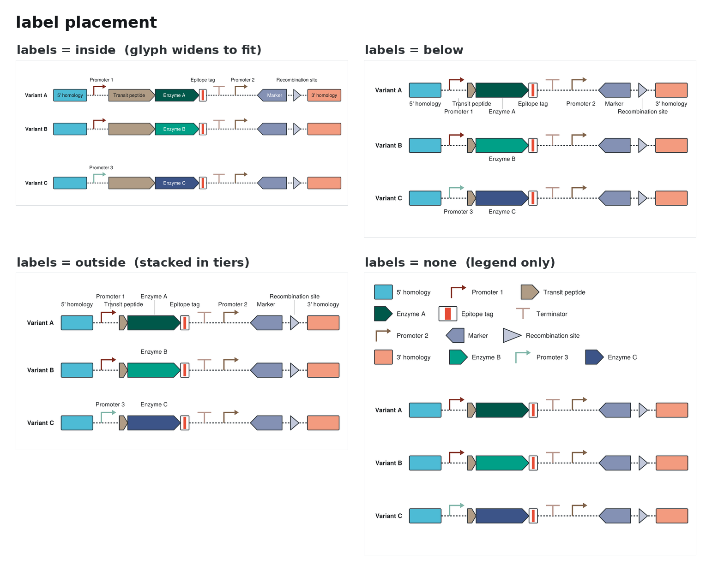
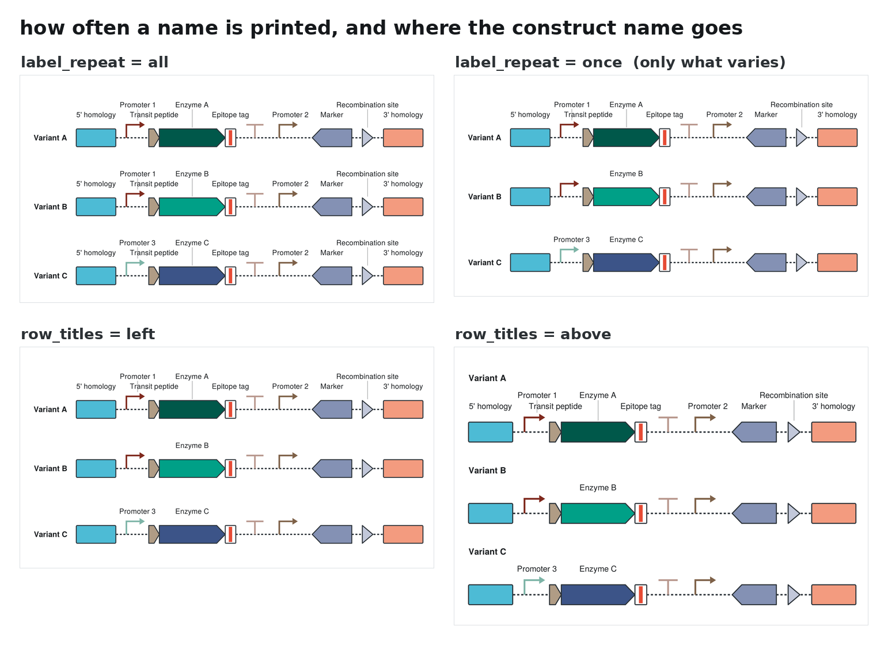
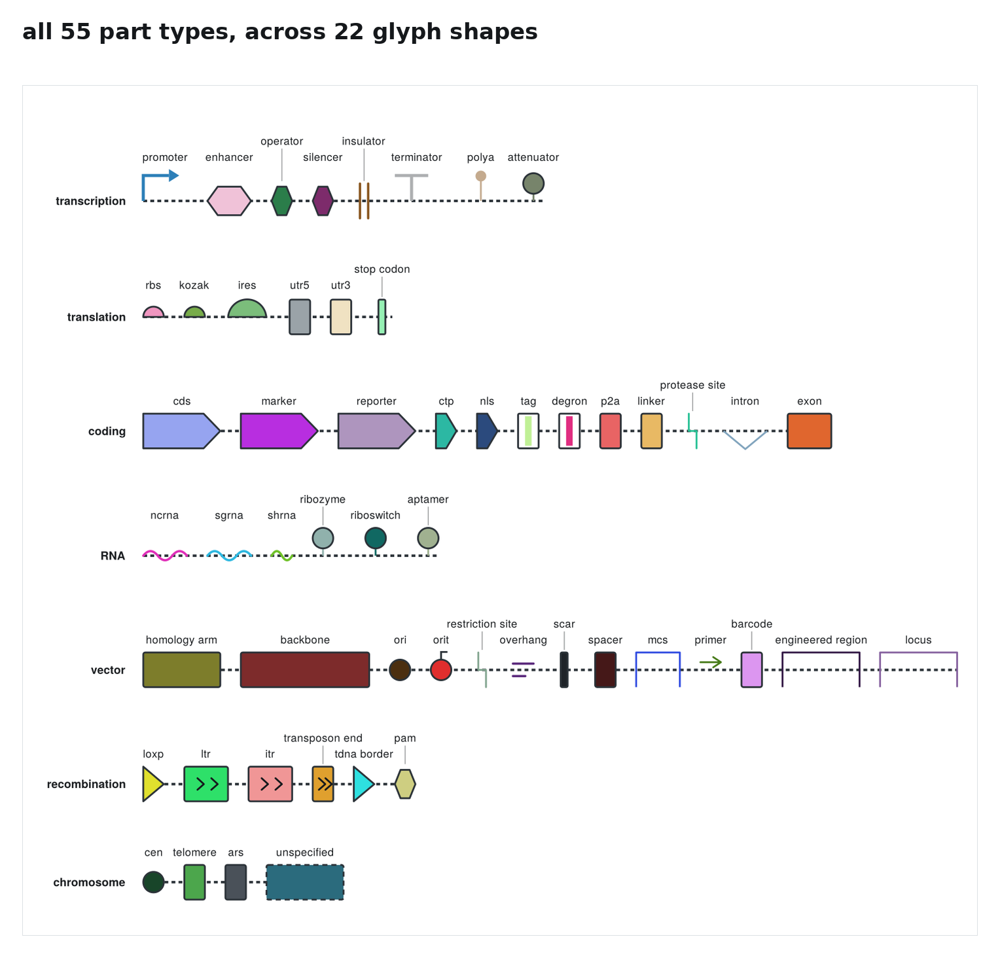

# cistron

Draw genetic construct maps from a spreadsheet. Output is editable SVG.



Each row of the workbook is one part. Rows sharing a name become one
construct. The look is set by one word in the settings sheet.

```bash
pip install openpyxl
python3 cistron.py
```

No arguments needed. `constructs.xlsx` ships filled in with three example
constructs and is the file you edit.

---

## Install

There is one required dependency. Open a terminal and paste these four lines:

```bash
git clone https://github.com/KaianTeles/cistron.git
cd cistron
pip install -r requirements.txt
python3 cistron.py
```

That writes `figure.svg` next to `constructs.xlsx`. If `pip` is not found, use
`pip3`; if `python3` is not found, use `python`. Python 3.8 or newer — macOS
and most Linux installs already have it, and on Windows the installer at
[python.org](https://www.python.org/downloads/) works (tick *Add Python to
PATH*).

**Don't want to use git?** Click *Code → Download ZIP* at the top of this page,
unzip it, then `cd` into the folder and run the last two lines.

### Optional extras

| you want | install |
|---|---|
| PNG or PDF instead of SVG | `pip install cairosvg` |
| to rebuild the gallery images in this README | `pip install cairosvg pillow` |

Neither is needed to draw a figure.

### Everything you can run

```
python3 cistron.py                     # draw constructs.xlsx -> figure.svg
python3 cistron.py --watch             # redraw automatically every time you save the workbook
python3 cistron.py --new my.xlsx       # start a second, separate workbook
python3 cistron.py --list              # every theme, palette and part type
python3 cistron.py --themes            # one sample figure per theme, from your own data
python3 cistron.py --check             # say what it would draw, write nothing
python3 cistron.py --help              # all of the above
```

For day-to-day work, leave `--watch` running: the figure updates every time
you save the workbook.

---

## What you type, and what you get



Type rows, run the command, get the figure. No code is edited at any point.

**The output is a real vector file.** Open `figure.svg` in Illustrator,
Inkscape (free), Affinity or Figma and every glyph is a separate object — nudge
one arrow, recolour one box, restyle the text, drop it into a bigger panel. The
labels are live text, not outlines, so they stay editable and searchable. If
you have `cairosvg` installed, cistron can write `.png` or `.pdf` directly by
changing the extension in the `outfile` setting.

---

## The workbook

Five sheets; the first tells you what to do.

| sheet | |
|---|---|
| **Start here** | three-step quickstart |
| **cassettes** | your constructs, one row per part — the only sheet you must touch |
| **settings** | how it looks, in labelled sections, every choice a dropdown |
| **colors** | optional: pin a colour to a part type or an exact label |
| **reference** | every theme, palette (as swatches) and part type |

The cassettes sheet works while you type: a rule draws a line above each new
construct, the `size` cell greys out on a part where size cannot apply, an
unrecognised type turns red, a row with no type dims to show it is skipped,
and every column heading carries a note on hover.

### `cassettes` — one row per part

| cassette | order | type | label | size | dir | join | color |
|---|---|---|---|---|---|---|---|
| Variant A | 1 | HA | 5' homology | M | | | |
| | 2 | prom | Promoter 1 | | | | |
| | 3 | ctp | Transit peptide | XS | | yes | |
| | 4 | cds | Enzyme A | L | | yes | |
| | 5 | term | | | | | |

- **cassette** — rows sharing this become one row of the figure. Leave it
  blank to continue the one above, so you name each group once.
- **order** — position within the construct. Blank falls back to sheet order.
- **size** — `XS` `S` `M` `L`, on parts where width means something.
- **dir** — `fwd` or `rev`.
- **join** — `yes` sits flush against the previous part: a fusion.
- **color** — optional hex for this row only; beats everything else.

A row with an empty `type` is skipped, so blank spacers are fine.

---

## Gallery

Every panel below is the same three constructs, redrawn by changing one cell.
Rebuild with `python3 examples/make_gallery.py`.

### Themes



### Palettes



### Where the names go



### How often a name is printed



### The part vocabulary



---

## Themes

A theme is a **style** (geometry and ink) plus a **palette** (colour). Set
`style` and `palette` separately to mix any of the 130 combinations.

| theme | for |
|---|---|
| `journal` `publication` `print` | papers — hairline strokes; `publication` uses Okabe–Ito |
| `poster` `keynote` `slides` | talks — thick or rounded, saturated |
| `midnight` `blueprint` | dark backgrounds |
| `lineart` `engraving` `swiss` `muted` | hollow or flat; cheap to print |
| `watercolour` `sepia` `blossom` | pale fills, saturated outlines |
| `gradient` | perceptually ordered, when pathway position is the message |
| `classic` | the original look |

Palettes include Okabe–Ito, Paul Tol bright and muted, viridis and cividis, so
a colour-blind-safe figure is one cell away. `--themes` writes one sample SVG
per theme from your own data.

---

## Size

You set the figure's real-world size in the `settings` sheet, in centimetres,
so it drops into a column or a slide at the size you meant.

| setting | |
|---|---|
| `figure_width_cm` | the finished width — a one-column figure is about 8.5 cm, a two-column one about 17.5 |
| `figure_height_cm` | leave blank and the height follows from the drawing; set it and the figure is scaled down to fit inside the box, with blank side margins if it has to be |
| `cassette_spacing` | vertical room per construct, so rows can breathe or pack tight |
| `label_pt` | label size, before any scaling |
| `export_each` / `export_width_cm` | also write one file per construct, at their own width |

Set the width; the rest have working defaults. The output is vector, so these
values cost no resolution. They matter because they fix how large the text
ends up on the page, which is what the sanity check watches: ask for 20
constructs in 6 cm and it reports that the labels will land at 4.9 pt, and
what to change.

---

## Labels

| `labels` | |
|---|---|
| `none` | legend only |
| `inside` | the name sits in the glyph, which widens to fit it |
| `outside` | the name sits above, stacked in tiers so nothing collides |
| `below` | the same, under the backbone |

`label_repeat = once` prints each name only the first time it appears, so a
figure of near-identical constructs names only what actually varies. A
suppressed glyph keeps the width its label would have needed, so rows stay
aligned column to column. `row_titles` puts the construct name beside or above
each row, and `show_legend = auto` drops the legend when the glyphs are named.

---

## Colour

You do not have to choose any. Every part takes a colour from the theme's
palette, and **the colour follows the label**, so it survives adding, removing
and reordering constructs, and the same gene keeps its colour across figures
drawn from the same palette. Assignment hashes the label, then checks each
candidate in CIE Lab against the colours already placed, because a free
palette slot is not the same thing as a colour that looks different.

If a figure has more parts than the palette has hues, the palette is extended
with tints and shades of its own colours rather than repeating one, so two
genes never come out identical.

Precedence, highest first:

1. the `color` cell on a row — that part only
2. the `colors` sheet — a part type or an exact label; label beats type
3. the palette, automatically

Write `auto` in a hex cell to hand a name back to the palette.
`palette_mode = theme` ignores the sheet without deleting anything.

---

## Part types

55 part types across 22 glyph shapes.

**These are not SBOL Visual glyphs.** The *vocabulary* was chosen with
reference to [SBOL Visual](https://sbolstandard.org/visual-glyphs/), but the
shapes are hand-drawn and approximate, and some differ from the standard (an
operator is a hexagon here rather than a rectangle). Do not describe output
from this tool as SBOL-compliant. The official artwork is at
[SynBioDex/SBOL-visual](https://github.com/SynBioDex/SBOL-visual) under CC0;
for standard-compliant rendering use
[paraSBOLv](https://github.com/intbio-ncl/parasbolv) or
[dnaplotlib](https://github.com/VoigtLab/dnaplotlib).

| group | types |
|---|---|
| Transcription | `promoter` `enhancer` `operator` `silencer` `insulator` `terminator` `polya` `attenuator` |
| Translation | `rbs` `kozak` `ires` `utr5` `utr3` `stop_codon` |
| Coding | `cds` `marker` `reporter` `ctp` `nls` `tag` `degron` `p2a` `linker` `protease_site` `intron` `exon` |
| RNA | `ncrna` `sgrna` `shrna` `ribozyme` `riboswitch` `aptamer` |
| Vector | `homology_arm` `backbone` `ori` `orit` `restriction_site` `overhang` `scar` `spacer` `mcs` `primer` `barcode` `engineered_region` `locus` |
| Recombination | `loxp` `ltr` `itr` `transposon_end` `tdna_border` `pam` |
| Chromosome | `cen` `telomere` `ars` `unspecified` |

167 spellings resolve to these, so `ha`, `gene`, `prom`, `frt`, `attB`, `5utr`,
`grna`, `his` and `origin` all work.

### Size applies only where length is real

A part declares `scale` in the registry. **Length-bearing** parts (32) occupy
sequence, so `XS`–`L` is a real statement and they widen to hold an inside
label. **Position markers** (23) — `loxp`, `ori`, `promoter`, `restriction_site`,
`pam` — mark a point; drawing one wider would assert a longer feature, so they
render at one canonical width and ignore `size`. Setting a size on one is
reported rather than silently dropped, and a scalable type drawn with a glyph
that cannot stretch raises at import.

Adding a part type is one entry in `PART_TYPES`. Nothing else enumerates types
— aliases, default sizes, label placement, legend alignment and the draw
dispatch all derive from it, and an alias clash raises at import.

---

## Sanity check

After writing the SVG, cistron checks whether what you asked for is legible at
the size you asked for, and prints a warning with a concrete fix. It never
changes your settings and never refuses to draw.

```
WARNING 1  glyph labels render at 4.9 pt, under your min_label_pt of 6.
           Fixes, any one of: widen figure_width_cm to 9.2 cm;
           raise label_pt to 13; or shorten the names.
```

It catches labels below `min_label_pt`, a `figure_height_cm` too short for the
drawing, a legend inflated until it rivals the constructs, inside labels
stretching a glyph past its chosen size, a size set on a part that cannot use
one, a palette with fewer hues than the figure needs, outside labels stacking
into tiers, and **colours that collapse for a red-green colour-blind reader**
— about 1 in 12 men. The colour-vision check uses the Machado (2009) matrices
on the colours actually in your figure, and stays quiet when colour is not
carrying the identity anyway.

---

## Tests

```bash
python3 tests/run_all.py
```

118 checks: malformed input, every theme × label × repeat combination, every
style × palette pair, SVG well-formedness, determinism, layout invariants,
colour stability under edits, colour-vision behaviour, the workbook builder,
every CLI path, and repository hygiene. CI runs them on Python 3.8 through
3.13 — the f-string rules differ before 3.12, which is easy to ship by
accident.

---

## Notes and limits

- Text width is estimated from per-character advance widths for a
  Helvetica-like stack. Accurate to a few percent, but a very different
  substituted font shifts inside-label centring slightly.
- Drop shadows (`soft`, `slides`, `keynote`) use `feDropShadow`, which some
  older vector editors rasterise on import. Other styles are pure paths.
- Colour is a weak channel past about a dozen categories. Beyond that, name
  the glyphs (`labels = outside`) rather than reaching for a bigger palette.

## Contributing

Issues and pull requests welcome. New palettes and styles are a one-line
addition to `PALETTES` or `STYLES`; please include a sample rendering.

## License

MIT — see [LICENSE](LICENSE). If you use cistron in a publication, see
[CITATION.cff](CITATION.cff).
